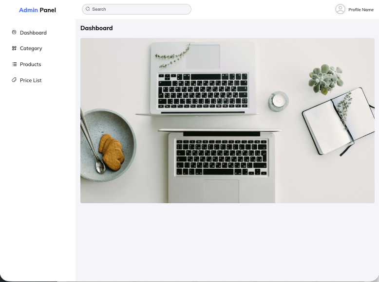

# Admin Dashboard

A responsive Admin Dashboard built with React as part of my front-end development learning journey. This project focuses on authentication, dashboard management, routing, and responsive user interface design.

## Overview

The application starts with Login and Sign Up pages. After successful authentication, users are redirected to the dashboard, where they can manage categories and review or update pricing information.

## Features

- Authentication System

  - Login page
  - Sign Up page

- Dashboard

  - Centralized admin panel interface
  - Easy navigation between sections

- Category Management

  - Create new categories
  - Edit existing categories

- Price Management

  - View price data
  - Update pricing information

- Responsive Design

  - Optimized for desktop, tablet, and mobile devices

- Routing

  - Implemented using React Router

## Technologies Used

- React
- React Router
- JavaScript (ES6+)
- CSS3

## Screenshot

## Learning Goals

This was one of my first React projects and was built to practice:

- Component-based architecture
- Client-side routing with React Router
- Building responsive layouts
- Managing application structure
- Creating reusable UI components

## Future Improvements

- API integration
- State management with Context API or Redux
- User role permissions
- Dark mode support
- Improved form validation
